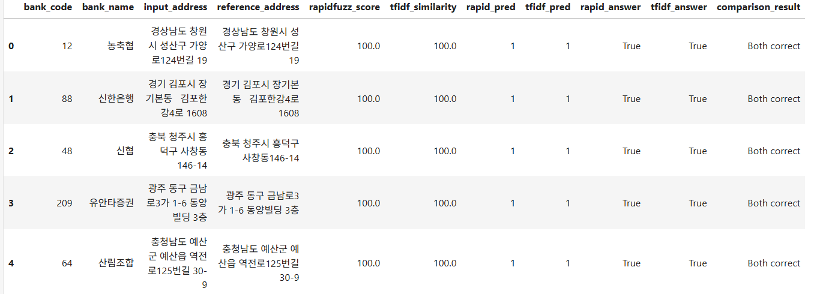
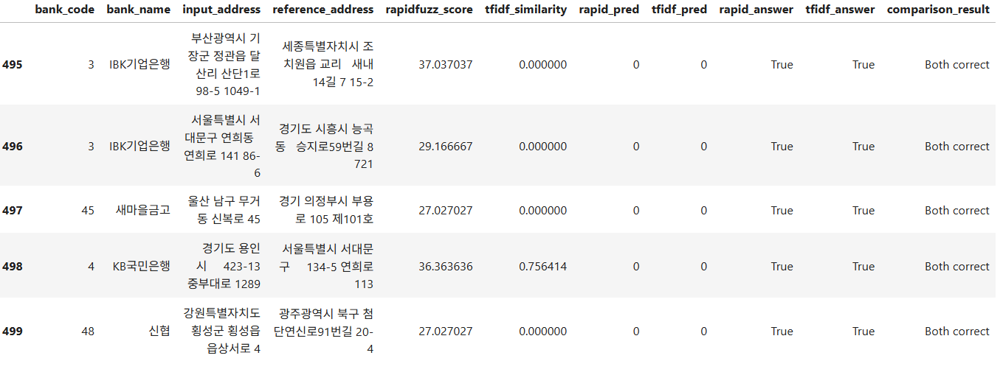

# 1104
## 오늘 계획


## Rapidfuzz vs TF-IDF

### 각 벡터화 비교
- Rapidfuzz는 **두 문자열이 얼마나 비슷한지를 빠르게 계산하는 문자열 유사도 라이브러리** 임.
- TF-IDF는 특정 단어 (또는 문자) 가 얼마나 중요한 지 숫자로 표현함. 흔하게 등장하는 단어보다 상대적으로 드물게 등장하는 단어에 중요도를 부여함.
TF (Term Frequency): 특정 단어가 얼마나 **자주** 등장하는지?
IDF (Inverse Document Frequency): 전체 문서에서 해당 단어가 얼마나 **드물게** 등장??

예를 들어, 
- 서울시 강남구 테헤란로 432
- 서울시 강남구 테헤란로 422
- 서울 중구 세종대로 110
이 있을 때 서울은 어디에나 있으니 **중요도 낮음**. 강남구와 테헤란은 일부 문장에 있기 때문에 **중요도 보통**. 하지만 432, 433 110은 처음 등장하기에 **중요도 높음**

따라서 Rapidfuzz와 TF-IDF의 성능을 비교하고 도입하는 게 맞다고 판단.

*추가적으로 bge-m3 임베딩을 도입하지 않은 건 bge-m3는 두 텍스트가 의미적으로 얼마나 비슷한 지를 보는 거라, 해당 프로젝트에서는 필요 없다고 판단함*

### Rapidfuzz

1. 원본 데이터를 AI에 주고 테스트 데이터 생성

```
|    |   bank_code | bank_name   |      branch_code | branch_name   | input_address              | reference_address          |   actual_match | error_type   | is_synthetic   | label_basis    |   reference_branch_code |   rapidfuzz_score |
|---:|------------:|:------------|-----------------:|:--------------|:---------------------------|:---------------------------|---------------:|:-------------|:---------------|:-------------------------|------------------------:|------------------:|
|  0 |         012 | 농축협         | 147840           | 남창원 대남        | 경상남도 창원시 성산구 가양로124번길 19   | 경상남도 창원시 성산구 가양로124번길 19   |              1 | exact        |False          | identical source address |        147840           |               100 |
|  1 |         088 | 신한은행        |    nan           | 김포장기          | 경기 김포시 장기본동   김포한강4로 1608  | 경기 김포시 장기본동   김포한강4로 1608  |              1 | exact        | False          | identical source address |           nan           |               100 |
|  2 |         048 | 신협          | 487681           | 창신 서부지소       | 충북 청주시 흥덕구 사창동146-14       | 충북 청주시 흥덕구 사창동146-14       |              1 | exact        | False       | identical source address |        487681           |               100 |
|  3 |         209 | 유안타증권       |      2.09024e+06 | 금융센터광주본부점     | 광주 동구 금남로3가 1-6 동양빌딩 3층    | 광주 동구 금남로3가 1-6 동양빌딩 3층    |              1 | exact| False          | identical source address |             2.09024e+06 |               100 |
|  4 |         064 | 산림조합        | 644110           | 예산군산림조합       | 충청남도 예산군 예산읍 역전로125번길 30-9 | 충청남도 예산군 예산읍 역전로125번길 30-9 |              1 | exact | False          | identical source address |        644110           |               100 |
```

**주소 및 회사명 정규화 전**
```
              count       mean        std        min        25%        50%         75%    max
actual_match                                                                                 
0             200.0  49.204880  15.951214  22.222222  35.601218  50.396825   59.736842   96.0
1             300.0  97.390415   2.987451  83.870968  96.359890  98.076212  100.000000  100.0
```

**주소 및 회사명 정규화 후**
```
              count       mean        std        min        25%         50%        75%         max
actual_match                                                                                      
0             200.0  47.039461  14.779021  20.895522  34.146341   45.080645   57.28022   95.652174
1             300.0  99.037095   2.162530  85.714286  98.331895  100.000000  100.00000  100.000000

```
- 일치 주소 평균 유사도: 99.04점
- 불일치 주소 평균 유사도: 47.04점
- 불일치 주소 최고 유사도: 95.65점

임계값 (Threshold) 별 성능 파악 **Rapidfuzz**

```
Threshold: 80
Precision: 0.9803921568627451
Recall: 1.0
F1 Score: 0.9900990099009901

Threshold: 85
Precision: 0.9900990099009901
Recall: 1.0
F1 Score: 0.9950248756218906

Threshold: 90
Precision: 0.9932885906040269
Recall: 0.9866666666666667
F1 Score: 0.9899665551839465

Threshold: 95
Precision: 0.996551724137931
Recall: 0.9633333333333334
F1 Score: 0.9796610169491525

Threshold: 98
Precision: 1.0
Recall: 0.7866666666666666
F1 Score: 0.8805970149253731
```
-> 우선 threshold = 85 로 생각

### TF-IDF

```
              count       mean        std        min        25%         50%         75%    max
actual_match                                                                                  
0             200.0  12.451612  20.723406   0.000000   0.000000    2.766636   14.889892  100.0
1             300.0  94.417565   9.381931  60.923537  87.260339  100.000000  100.000000  100.0
```

**임계값** 은 [70, 75, 80, 85, 90, 95]로 두었음.
- actual_match가 0인데, max가 100인 input_bank_name과 reference_bank_name은
```
서울 영등포구 국제금융로 39 (여의도동, 브라이튼 여의도) / 서울 영등포구 국제금융로 39 (여의도동, 브라이튼 여의도)32층 였음
```

### 공통점
- 층까지 구분을 못하는 거 같음. input_bank_name이 reference 안에 속해 있으면 100점으로 나옴.

### 추가사항
```"050_001": {"name": "BNK저축은행", "aliases": ["비엔케이저축은행"]}``` 라는 json 데이터가 있고,

```
for code, v in company_alias.items():
    for a in [v["name"], *v["aliases"]]:
        name_to_code.setdefault(norm_company(a), set()).add(code)
```
가 있을 때, *v["aliases"] 는 비엔케이저축은행 을 갖고오는 거고, v["aliases"] 는 [비앤케이저축은행] 을 의미함.

### 오류분석
- Rapidfuzz의 성능이 더 좋지만, 오류의 경우 어떤 모델의 점수가 더 높은지 파악하기 위함

```
Both correct      491
Rapidfuzz Only      9
```

-> `combine_test.py` 참고

<head>


<tail>


### Precision, Recall, F1-Score 란?
- Precision: **알고리즘이 '일치한다'고 판단한 주소 중 실제로 일치하는 비율**
- Recall: **실제로 일치하는 주소 중 알고리즘이 일치한다고 찾아낸 비율**
- F1-Score: **Precision과 Recall을 종합해서 평가하는 점수**
